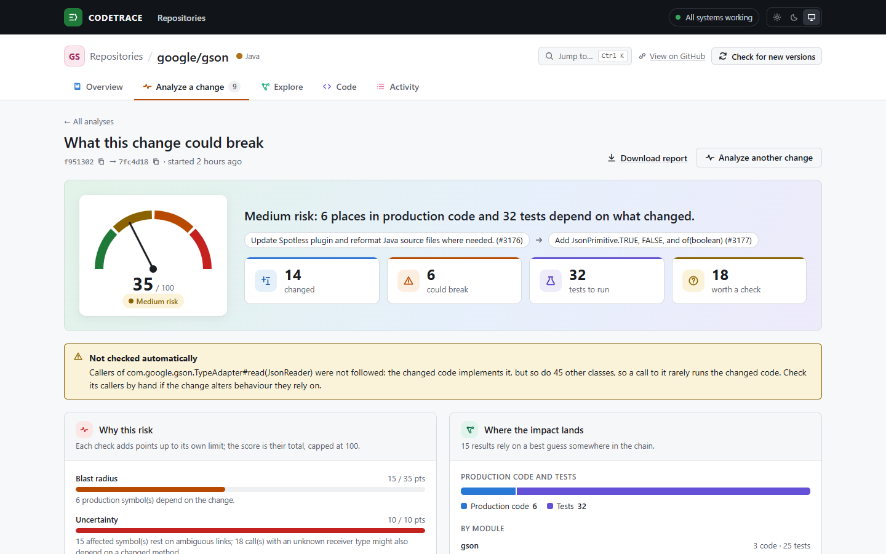
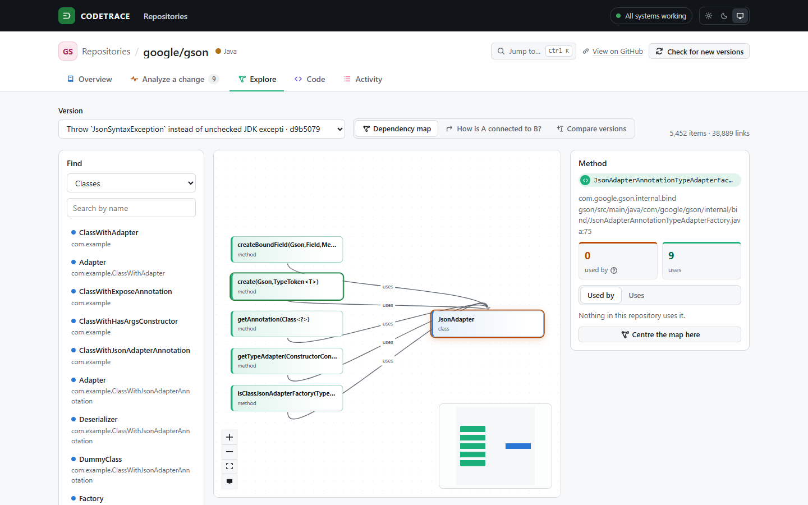
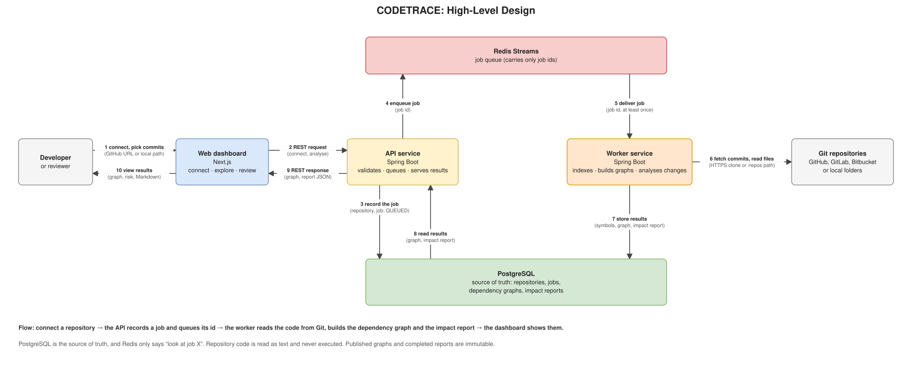
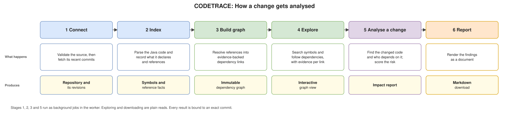

<div align="center">

# CODETRACE

### Know what a code change could break before you merge it.

CODETRACE reads a Java repository, maps how its code depends on itself, and for any change between two commits tells you<br>
**what changed, what could break, which tests to run and how risky it is**, with the file and line behind every claim.

[](https://github.com/karanupd12/codetrace/actions/workflows/ci.yml)


[Overview](#overview) · [Features](#features) · [System design](#system-design) · [How it works](#how-it-works) · [Quick start](#quick-start) · [Performance](#performance) · [Security](#security)



</div>

---

## Overview

Reviewing a change usually means guessing what else it touches. Text search misses indirect callers, overloaded methods and interface implementations, and a tool that pretends to be certain is worse than none.

CODETRACE is built on four rules:

- **Evidence, not guesses.** Every dependency points to the file and line that justify it. Every affected symbol carries the chain of calls that links it to the change.
- **Uncertainty is visible.** When more than one target is plausible, the result is marked *possibly*. What the analysis deliberately does not follow is written down as a note.
- **Reproducible.** Every result is bound to exact commits and to the algorithm version that produced it, and never changes once published.
- **Safe on untrusted code.** Repositories are read and parsed as text. Nothing is ever built or executed.

## Features

| | |
|---|---|
| **Change impact analysis** | Pick the version before and after a change. CODETRACE finds the classes, methods and fields that were added, changed or removed, then the production code that depends on them and the tests to run, nearest first, each with its evidence chain. |
| **Explainable risk score** | A deterministic 0–100 score (low, medium, high, critical) built from seven independent checks: blast radius, breaking API changes, size of the change, module spread, uncertainty, missing tests and analysis limits. Each check states its reason. |
| **API endpoint impact** | Spring MVC and JAX-RS endpoints are read from the code. A change is reported as adding, removing, changing or reaching an endpoint such as `GET /orders/{id}`. |
| **Tests to run** | Found through the code they exercise, and by naming convention (`OrderTest`, `OrderIT` → `Order`), so tests that work through mocks are still listed. |
| **Dependency map** | An interactive map of classes, methods and fields and how they call, use, extend, implement, override and test each other, with provenance on every link. |
| **Path finder and version comparison** | "How is A connected to B?" shows the shortest dependency chains between any two symbols. Comparing two versions shows which code and connections appeared or disappeared. |
| **Markdown report** | A downloadable report that names the exact commits, dependency maps and algorithm, so anyone can reproduce it. |
| **Live progress** | Every background task reports its steps in plain words as it runs ("Reading the code", "Building the dependency map", "Analysis ready: medium risk"). |
| **Fast repeat scans** | A new commit reuses the results of every file whose content did not change, so later scans take a fraction of the first. |



---

## System design



CODETRACE is a **modular monolith**: one Spring Boot codebase that runs in two roles, chosen by profile.

| Component | Responsibility |
|---|---|
| **Web dashboard** (Next.js) | Connect repositories, prepare versions, analyse changes, explore the map, follow live progress. |
| **API** (Spring Boot, `api` profile) | REST endpoints and validation. Records each job in PostgreSQL, then queues its id. Serves maps, reports and progress. |
| **Worker** (Spring Boot, `worker` profile) | Consumes jobs: syncs Git, scans code, builds dependency maps, analyses changes. Exposes no REST endpoints. |
| **PostgreSQL** | The source of truth: repositories, jobs and their progress, symbols, dependency maps and reports. Schema managed by Flyway. |
| **Redis Streams** | Carries job ids only, so losing or duplicating a message is harmless. |

**Design decisions**

- **Idempotent, at-least-once jobs.** A worker claims a job with one atomic conditional `UPDATE`, so a message delivered twice still runs once. Messages are acknowledged only after the outcome is stored. Transient failures are retried, and exhausted jobs move to a dead-letter stream.
- **Immutable, versioned results.** Each dependency map belongs to one commit and one resolver version. It is validated in SQL and published in one atomic step, so readers never see a half-built map. Database triggers reject changes to published maps and completed reports.
- **Integrity in the database.** Composite foreign keys keep every link inside its own map, and check constraints tie each resolution state to the fields it requires.
- **Bounded everything.** Clone size and time, file counts, parse time, map size, traversal depth and result sizes all have limits.

---

## How it works



| Stage | What happens |
|---|---|
| **1. Connect** | The source is validated (allow-listed host, public addresses only), then a bare, depth-limited clone fetches recent history. Redirects are refused, and the size limit is enforced during the download. |
| **2. Index** | Files are read straight from Git objects, with no checkout, and parsed with JavaParser into declarations, references, argument types and HTTP endpoints. Unchanged files are copied from an earlier scan. |
| **3. Build graph** | References are resolved into nodes and links through scopes, imports, supertypes and overload rules. Every link records its evidence and confidence. The map is validated and published atomically. |
| **4. Explore** | Search, neighbourhoods, shortest paths and version comparison, read from published maps. |
| **5. Analyse a change** | Diff the two commits, map changed lines to symbols, walk the dependency map backwards, compare endpoints and score the risk. |
| **6. Report** | The completed report is read-only and renders to the same Markdown every time. |

### Analysing a change

1. **Diff.** The two commits are compared in Git with rename detection. A small lexer drops edits to comments, Javadoc and blank lines.
2. **Changed symbols.** Each edit marks the innermost declaration it touches. A changed signature counts as a removal plus an addition, which is what breaks callers.
3. **What could break.** A bounded breadth-first search follows calls, uses, `extends` and `implements` *backwards* through the **before** version's map. It also follows a changed implementation to callers of its interface method when that method has five implementations or fewer, and marks those results *possibly*.
4. **Tests to run.** Tests reached by that search, plus test classes named after a changed or affected class.
5. **Evidence.** Each affected symbol keeps its shortest chain to the change, with file and line per step. Calls whose receiver type is unknown are listed for a manual check, not counted.
6. **Risk and notes.** Seven checks add up to the score. Anything deliberately not followed, such as an interface with 46 implementations, becomes a plain note in the report.

### The dependency model

| | |
|---|---|
| **Nodes** | `PACKAGE` · `FILE` · `TYPE` · `METHOD` · `FIELD` |
| **Links** | `CONTAINS` · `IMPORTS` · `EXTENDS` · `IMPLEMENTS` · `OVERRIDES` · `REFERENCES` · `CALLS` · `TESTS` |
| **Resolution** | `RESOLVED` (one provable target) · `AMBIGUOUS` (one link per remaining candidate, grouped) · `UNRESOLVED` (with a reason, such as a JDK type or an unknown receiver) |

Every link stores its type, resolution state, confidence, source file and line, and the versions of the parser and resolver that produced it.

---

## Quick start

**Requirements:** Docker with Compose v2.

```bash
git clone https://github.com/karanupd12/codetrace.git
cd codetrace
cp .env.example .env              # Windows PowerShell: Copy-Item .env.example .env
docker compose up --build
```

Open **http://localhost:3000**, paste a public repository link such as `https://github.com/google/gson`, then:

1. **Prepare** a version on the Overview tab (scan and map it).
2. Open **Analyze a change**, pick the *before* and *after* versions and click **Analyze**. Versions that are not prepared yet are prepared first.
3. Read the result, open **Why?** on any row for its evidence, or download the report.

| Service | Address |
|---|---|
| Dashboard | http://localhost:3000 |
| REST API | http://localhost:8080/api/v1 |
| Health | http://localhost:8080/actuator/health |

Optional job monitoring: `docker compose --profile tools up -d` starts RedisInsight (http://localhost:5540) and Dozzle for live logs (http://localhost:8888). Stop everything with `docker compose down`; add `-v` to delete the data too.

To try a local repository, run `./scripts/make-demo-repo.sh` (Windows: `.\scripts\make-demo-repo.ps1`) and connect `/repos/demo-java`.

### REST API at a glance

| Endpoint | Purpose |
|---|---|
| `POST /repositories` | Connect a repository (GitHub URL or allowed local path) |
| `POST /repositories/{id}/index-jobs` · `/graph-snapshots` | Scan a commit; build and publish its dependency map |
| `GET /index-jobs/{id}/events` | A job's progress steps, in plain words |
| `GET /snapshots/{id}/graph` · `/paths` · `/compare/{head}` | Neighbourhood, shortest paths, version comparison |
| `POST /repositories/{id}/impact-reports` | Analyse the change between two commits |
| `GET /impact-reports/{id}` · `/findings` · `/summary` · `/report.md` | Risk and reasons, paged findings with evidence, counts, Markdown report |

Errors follow [RFC 7807](https://www.rfc-editor.org/rfc/rfc7807), and every response carries an `X-Correlation-Id`.

---

## Performance

Measured on [google/gson](https://github.com/google/gson) (268 Java files, 5,137 symbols) with the full Docker Compose stack on a laptop: Intel Core i5-1240P, 8 GB RAM, Windows 11, Docker Desktop. Job times come from each job's own start and finish timestamps.

| Step | Result |
|---|---|
| Sync (depth-50 clone over the network) | 14.6 s |
| Scan, first commit | 3.6–4.7 s |
| Scan, next commit (259 of 268 files reused) | 1.2–1.7 s |
| Dependency map build | 5,428 nodes, about 38,600 links; 5–16 s per build |
| Change analysis (commit `7fc4d18` against its parent, depth 4) | 3.7 s: 14 changed symbols, 6 production symbols and 32 tests affected, risk 35 (medium) |

| Map query (20 sequential requests after warm-up, client-side) | p95 |
|---|---|
| Node search | 13–18 ms |
| Neighbourhood, depth 3 (223 nodes, 499 links) | 73–81 ms |
| All shortest paths | 7–9 ms |

The query figures were measured before override and test links were added to the map. Concurrent load has not been measured.

**Accuracy:** five hand-labelled change scenarios run through the full pipeline (body change, signature change, deleting unused code, unknown receiver, change reached through an interface) each score precision and recall of 1.00. The fixture is small, so treat this as a correctness check rather than a general accuracy figure.

---

## Security

Repository content is treated as **untrusted input**.

- **Never executed.** Code is read from Git objects and parsed as text. No checkout, build, test or hook ever runs.
- **Restricted sources.** Remote URLs must be `https://` on an allow-listed host (GitHub, GitLab, Bitbucket), with no credentials, and must resolve to public addresses. This is checked at registration and again before cloning. Redirects are refused. Local folders are disabled unless root folders are configured.
- **Bounded work.** Size, time, file-count, parse-time, map-size, depth and result limits apply at every stage.
- **No leaks.** Logs and errors carry ids and categories, never source code, server paths or credentials. Containers run as a non-root user.

Only public repositories are supported. Please report vulnerabilities to the maintainer privately rather than in a public issue.

---

## Tech stack

| Layer | Technology |
|---|---|
| Backend | Java 21, Spring Boot 3.5, Spring JDBC (explicit SQL, no ORM), Flyway |
| Code analysis | JavaParser, JGit (reads Git objects directly) |
| Data and queue | PostgreSQL 17 (`pg_trgm`), Redis 7.4 Streams |
| Frontend | Next.js 15, React 19, TypeScript, React Flow, Dagre |
| Testing | JUnit 5, AssertJ, Mockito, Testcontainers, Awaitility |
| Delivery | Docker Compose, GitHub Actions |

## Project structure

```
codetrace/
├── backend/            Spring Boot application (API and worker roles), feature-first packages
│   └── src/main/java/dev/codetrace/
│       ├── source/      registered repositories     ├── graph/    resolution, dependency maps, queries
│       ├── ingestion/   Git access, parsing, scans  ├── impact/   change detection, analysis, risk
│       ├── symbols/     scan results                ├── report/   Markdown report
│       ├── jobs/        queue, retries, progress    └── system/   status and retention
├── frontend/           Next.js dashboard
├── assets/             README images and diagrams
├── test-fixtures/      sample source trees for tests and demos
├── scripts/            demo repository builders
└── docker-compose.yml
```

## Contributing

Contributions are welcome. Fork the repository, branch from `main`, and run the checks before opening a pull request:

```bash
cd backend  && ./mvnw clean verify                     # unit and Testcontainers tests (Docker required)
cd frontend && npm ci && npm run lint && npm run build
```

Keep changes focused, add tests for new behaviour, and use conventional commit messages (`feat(graph): ...`, `fix(impact): ...`). CI must pass.

## Roadmap

- AI explanations of a report, grounded only in its evidence (no generated links or scores)
- Load testing and broader accuracy benchmarks
- Incremental dependency-map builds
- Private repositories and more languages

## License

A license has not been chosen yet.
